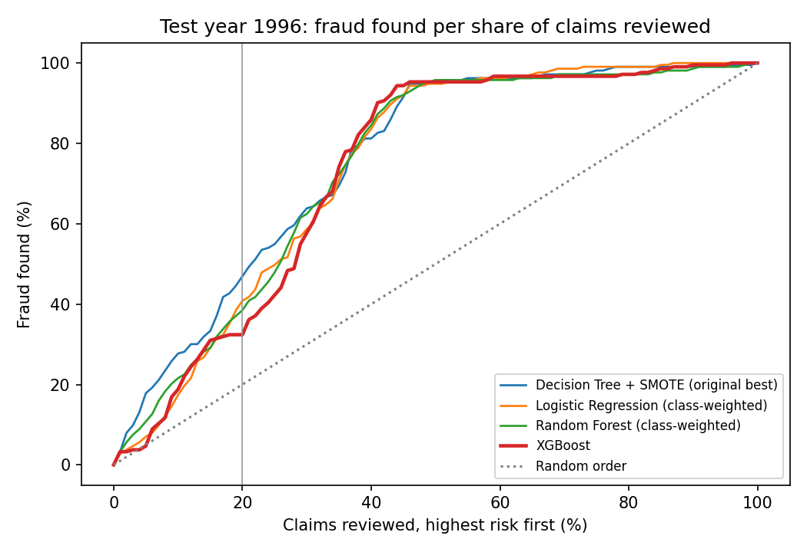
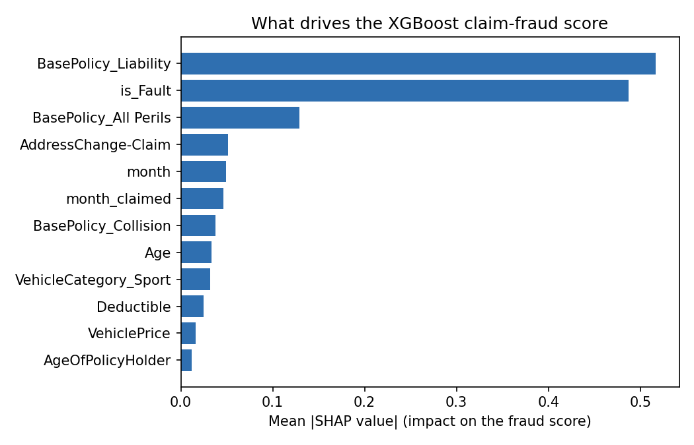

# Insurance Claim Fraud Detection

> Machine Learning coursework, The British University in Egypt, 2026. Author: Ziad Ayman.

Which vehicle insurance claims deserve a fraud investigation? 15,420 claims from 1994–1996, **6% fraudulent**, described by 32 mostly text-coded attributes (policy type, fault, vehicle price range, days between policy start and accident, address changes...). The models are trained on earlier years and tested on the **following year**, the way an insurer would actually use them, and every experiment is tracked in **MLflow**.

## Results (test year 1996: 4,083 claims, 213 fraudulent)

| Model | PR-AUC (95% interval) | ROC-AUC (95% interval) | Fraud found reviewing the riskiest 20% |
|---|---|---|---|
| **Decision Tree + SMOTE** | **0.144** (0.117–0.178) | **0.773** (0.747–0.797) | **47%** |
| XGBoost (GPU, tuned) | 0.128 (0.103–0.161) | 0.747 (0.724–0.771) | 32% |
| Random Forest (class-weighted) | 0.111 (0.094–0.138) | 0.755 (0.729–0.780) | 39% |
| Logistic Regression (class-weighted) | 0.102 (0.087–0.122) | 0.753 (0.730–0.775) | 41% |

Fraud is 5.2% of 1996 claims, so a random review of 20% of claims would find 20% of the fraud: the best model finds **2.3 times as much**, and reviewing the riskiest 45% of claims finds about 95% of all fraud.



**Honest notes**
- The 95% intervals (1,000 bootstrap resamples of the test year) overlap: with 213 fraud cases, the models are close, and the ranking could change in another year.
- A random 5-fold split of all years reports a ROC-AUC of **0.82** for the same XGBoost model. Testing on a future year (0.75) is lower and more realistic: fraud patterns drift from year to year.
- Precision is low for every model (about 11% at the chosen thresholds), which is normal for this dataset: the attributes describe the policy and the claim, not the evidence an investigator gathers.

## What drives fraud risk (SHAP, XGBoost)


Liability-only policies are almost never fraudulent (0.7%), while All Perils policies (10.2%) and claims where the policy holder is at fault (7.9% versus 0.9% for third-party fault) carry most of the risk. Recent address changes, the accident month and age add smaller effects, and sports cars are rarely involved (1.6% fraud versus 8.2% for sedans).

## Feature engineering
- **Ordered ranges.** Text ranges such as `"20,000 to 29,000"`, `"more than 30"` days or `"under 6 months"` since an address change are mapped to ordered numbers, so a model knows that "3 to 5" supplements is more than "1 to 2". Unexpected values raise an error instead of silently becoming missing.
- **Claim timing.** Months between the accident and the claim, from the accident and claim months (wrapping across the new year).
- **Data quality.** `Age = 0` is a placeholder used for 16–17-year-old policy holders, so it is treated as missing. `PolicyNumber` and `RepNumber` are identifiers and `PolicyType` duplicates two other columns, so they are dropped.
- **No leakage.** Scaling, one-hot encoding, imputation and SMOTE are all fitted inside the training pipeline. Thresholds are chosen on 1995 with models trained on 1994; the final models are retrained on 1994–1995 and tested once on 1996.

## Run it
```bash
pip install -r requirements.txt
# download the vehicle insurance claims dataset (carclaims.csv, 15,420 rows) into data/
python -m claimfraud                                  # trains and evaluates all four models
mlflow ui --backend-store-uri sqlite:///mlflow.db     # compare runs at http://localhost:5000
python -m pytest -q                                   # 7 tests
```

## Project structure
```
claimfraud/
├── data.py       # schema check, range-to-number mapping, claim timing, time split by year
├── models.py     # pipelines (SMOTE inside the pipeline), tuned XGBoost, review-share metric, bootstrap intervals
└── __main__.py   # training, threshold selection, MLflow tracking, figures, SHAP
tests/            # feature mapping, validation, time split, metrics, end-to-end run on synthetic claims
notebooks/        # the original coursework notebook
```

## What changed from the original coursework
The original notebook (in `notebooks/`) explored the data, compared KNN, SVM and a tuned decision tree, tried feature selection, clustering, voting, bagging and stacking ensembles, and handled the imbalance with SMOTE, class weights and SMOTE-Tomek, tracking everything in MLflow. Its best model, Decision Tree + SMOTE, reached an F1 of 0.215 and a ROC-AUC of 0.59 on a random split. This version keeps that approach and adds ordered range features and claim timing (**ROC-AUC 0.77 on a future year**), a time-based evaluation, tuned GPU XGBoost, confidence intervals, a review-capacity metric, SHAP explanations and tests.

## Tech stack
Python · scikit-learn · imbalanced-learn · XGBoost (CUDA) · MLflow · SHAP · pandas · matplotlib · pytest
